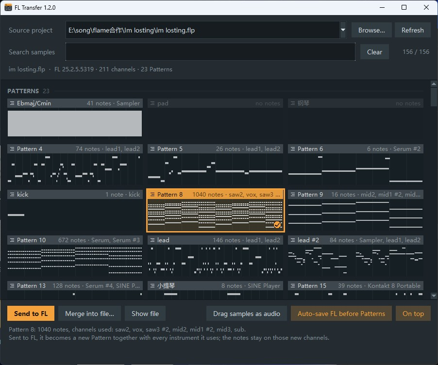

# FL Transfer (English edition)

Copies sample channels, plugin channels and Patterns between FL Studio projects. Tested with FL Studio 25.2.5.

**Download**: the installer and the portable zip are on the [Releases](https://github.com/LaDoSo/fl-transfer/releases) page (files with `-en` in the name). Python does not have to be installed.

**中文**：中文版在 [`main` 分支](https://github.com/LaDoSo/fl-transfer)。



The tool only reads the source project and never rewrites an existing `.flp`.

This tree is the English edition of FL Transfer 1.2.0: the window, the messages, the user guide and the installer are in English. The program logic is the same as in the Chinese edition.

- End-user documentation: [packaging/USER_GUIDE.txt](packaging/USER_GUIDE.txt) (shipped as `User Guide.txt`).
- Developer documentation is still in Chinese: [README.zh.md](README.zh.md) (the original README) and [docs/FORMAT.md](docs/FORMAT.md).

## Run from source

Double-click `FL Transfer.bat`, or:

```
set PYTHONPATH=src
python -m fltransfer gui
```

## Tests

```
python tests/test_audition.py
python tests/test_gui.py
...
```

Each file under `tests/` is run on its own.

## Build

```
python packaging/build.py
```

Needs PyInstaller, Pillow and NSIS 3 (`makensis` on PATH, in its usual install folder, or unpacked under `_tools/`). It writes:

- `release/FL Transfer/` – the application folder
- `release/FL-Transfer-<version>-en-win64.zip` – portable
- `release/FL-Transfer-Setup-<version>-en.exe` – installer

Self-test of a build: `"release/FL Transfer/FL Transfer.exe" --selftest report.json [project.flp]`

## License

[MIT](LICENSE). Third-party components shipped with the program are listed in [packaging/THIRD_PARTY.txt](packaging/THIRD_PARTY.txt).

FL Studio is a product and trademark of Image-Line. This tool is not an Image-Line product and is not affiliated with Image-Line.

