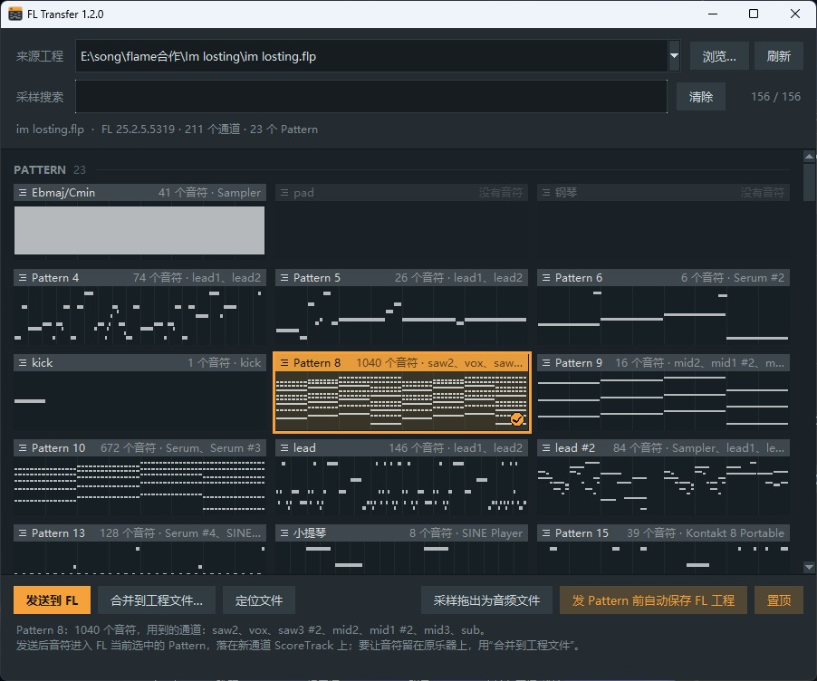

# FL Transfer

在 FL Studio 工程之间复制采样通道、插件通道和 Pattern。在 FL Studio 25.2.5 上实测通过，文件格式笔记见 [docs/FORMAT.md](docs/FORMAT.md)。

**下载**：安装版和免安装版（中文、英文）都在 [Releases](https://github.com/LaDoSo/fl-transfer/releases)，不需要安装 Python。使用方法见 [packaging/USER_GUIDE.txt](packaging/USER_GUIDE.txt)。

**English**: the English edition lives on the [`en` branch](https://github.com/LaDoSo/fl-transfer/tree/en); English builds are on the Releases page.

工具只读来源工程，从不改写已有的 `.flp`。

## 窗口



双击 `FL Transfer.bat`（或运行 `python -m fltransfer gui`），在“来源工程”里选一个保存过的 `.flp`（下拉列表是 FL 最近打开的工程，也可以把 `.flp` 拖进窗口）。来源工程不需要在 FL 里开着。

工程里的内容按 FL 播放列表里片段的样子画出来：

- **Pattern**：标题栏加音符缩略图，颜色取工程里 Pattern 的颜色。
- **采样**：标题栏加波形，颜色取通道颜色，右上角是时长。波形只支持 WAV；mp3、m4a、ogg、flac 会显示成一条线并注明没有预览，照样可以传。
- **乐器通道**：插件通道和空采样器，只有标题和插件名。
- 灰掉的卡片不能传（Layer、自动化通道、没有音符的 Pattern）。

工程是从别的电脑拷来的、采样路径已经失效时，工具会在工程所在文件夹（含子文件夹）里按文件名找采样。找到了就能显示波形，发送出去的通道也会指向找到的文件。

点一下选中，Ctrl / Shift 点击多选，Ctrl+A 全选。来源工程在 FL 里改动后按 Ctrl+S，窗口会自动刷新。

在“采样搜索”里输入采样文件名或通道名的一部分即可实时筛选，英文忽略大小写。右侧显示匹配数和采样总数。被筛掉的采样会取消选中，在搜索框里按 Esc 或点“清除”可恢复完整列表。

### 试听采样

- **点波形**：从点的那个位置开始播放。正在播放时点别的位置，就跳到那里接着放。这一下同时也选中卡片，和以前一样。
- **播放钮**（采样卡片标题栏左端的小三角）：从头播放，再点一下停止。点它不会选中卡片。
- **空格**：选中一张采样卡片后按空格从头播放，再按停止。

播放时波形上有一条竖线跟着走，播完自动停。按住 Ctrl / Shift 点击只是多选，不出声；按住拖出去也不出声。

在波形上双击不再发送（否则连点两下试听会误发到 FL），算作两次点击。要双击发送，双击卡片的标题栏；Pattern 和乐器卡片的双击不变。

- 声音从 Windows 的默认播放设备出来，用的是系统自带的接口，不需要装任何东西。
- WAV（8/16/24/32 位整数、32/64 位浮点）由工具自己解码；其他格式（mp3 等）交给 Windows 自带的播放器，Windows 放不了的格式（常见的是 flac、ogg）会在状态栏说明。
- 听到的是原始文件：通道里的音高、裁剪、反向、音量这些设置不起作用。多于两个声道的文件只放前两个声道。超过两分钟的文件，从点的位置起一次最多连续放两分钟。
- Pattern 和乐器通道不能试听。
- FL 的声卡驱动如果独占了声卡（某些 ASIO 驱动），FL 开着的时候可能没有声音。

开发自检：`python tools/auditioncheck.py [工程.flp]`，送到声卡的是静音，不会出声。

## 传到另一个工程

FL Studio 可以安装在任意盘。发送和拖入 Pattern 时会优先定位打开目标工程的 FL，然后尝试已记住的位置、Windows 安装记录和默认安装目录。如果窗口提示选择 FL 程序，到安装文件夹选一次 `FL64.exe` 或 `FL.exe` 即可。

三种方式，选中卡片后使用：

| 方式 | 做法 | 结果 |
|---|---|---|
| **发送到 FL** | 先在 FL 里打开目标工程，点“发送到 FL”或双击卡片 | 立刻出现在 FL 当前工程里，不用重开工程 |
| **拖拽** | 把卡片拖进 FL 窗口 | 采样、乐器：和从资源管理器拖文件进 FL 一样。Pattern：在 FL 窗口上松开即发送，松在哪个位置都一样 |
| **合并到工程文件…** | 选一个目标 `.flp` | 生成目标工程的一份新副本，原文件不动；在 FL 里打开这份新文件 |

“发送到 FL”的效果（FL 25.2.5 实测）：

| 发送的卡片 | 在目标工程里出现的东西 |
|---|---|
| 采样 | 一个新的通道，名字、采样和通道设置都带过来 |
| 乐器通道 | 一个新的插件通道，带插件状态（目标电脑要装有这个插件） |
| Pattern | 一个新的 Pattern（名字、颜色、音符），加上它用到的**每一个音源**（新通道，带插件状态或采样）。音符在这些新通道上，和原工程的对应关系不变 |

一次选中多个 Pattern 再发送，它们共用的音源只加载一次。分几次发送，每次都会再加载一份音源。

### Pattern 带音源发送的前提

FL 不提供“当前工程有几个通道”的查询，而音符必须写明自己落在第几个通道上。唯一可靠的办法是让 FL 把工程保存一次，再从文件里读。所以窗口里**每次发送或拖入 Pattern 之前，工具都会先在 FL 里按一次 Ctrl+S**，等文件写完再编号、发送：

- 第一次会弹出询问。“是”＝保存并发送，以后不再问；“否”＝只这一次；“取消”＝不保存也不发送。窗口下方的开关“发 Pattern 前自动保存 FL 工程”就是这个选择，随时可改；关着时每次都会问。
- 不保存就不发送。早先的版本允许按“上次保存的通道数 + 工具自己发过的数量”来估算，只要在 FL 里删过或加过一个通道，音符就指向错误的通道，在 FL 里看到的就是“音源来了，没有 MIDI”。这条路已经从窗口里去掉了。
- 目标工程要保存过。没保存过的新工程先在 FL 里 Ctrl+S 一次，起个名字。
- FL 每次保存会照常在工程的 `Backup` 文件夹里留一份 `overwritten` 备份。FL 的备份文件夹最多留 100 个文件，满了会删最旧的；发得很频繁时，较早的备份会被挤掉。
- 保存时 FL 如果弹出提示框，工具会在状态栏提醒并等你到 FL 里回答，最多等 3 分钟，保存完成后继续发送。最常见的是 `Invalid data`（There are invalid notes in this project…）：工程里留着指向不存在通道的音符，也就是早先版本没对上通道的那些，点“是”让 FL 删掉它们即可。
- 工具从 FL 标题栏读工程文件名，再到最近打开的工程里找这个文件。找不到时会弹出文件选择框，让你指一次这个文件在哪。

发完 Pattern 后，工具等 FL 把音源加载完，再让 FL **切到新建的那个 Pattern**（相当于在数字小键盘上按对应的键）。这样通道机架里新音源那一行直接就是它的音符。不切的话 FL 停在原来的 Pattern 上，新音源那一行是空的，看起来像“没有 MIDI”。状态栏会写明切到了第几号；如果 FL 当时弹着提示框没能切过去，状态栏会写明要手动选第几号。

一个 Pattern 用到几个音源，就带过去几个音源，音符分别落在各自的音源上。一次选中多个 Pattern 时，共用的音源只加载一次，FL 切到其中第一个。

只发采样或乐器（不带 Pattern）不需要保存。

发送后想核对音源参数有没有变：让 FL 保存目标工程，然后 `python tools/samechannel.py 来源.flp 来源通道号 目标.flp 目标通道号`，它逐个事件比较两个通道，插件状态是压缩数据时解压后再比。

不想受这些限制时用“合并到工程文件”，它直接改文件副本，不依赖通道计数。

“采样拖出为音频文件”打开时，拖出采样卡片得到的是原始音频文件（和从资源管理器拖采样进 FL 一样）；关闭时是带全部通道设置的预设。这个开关只影响采样卡片的拖拽。

同时开着两个 FL 时，“发送到 FL”由 FL 自己决定哪个窗口接收。

### 窗口里的反馈

- 按住卡片：整张卡片变亮，带白色边框。选中：橙色标题栏、橙色边框、右下角一个勾。
- 拖 Pattern 卡片：一个小标签跟着鼠标，写着拖的是什么、带几个音源。鼠标到了 FL 窗口上标签变橙色，写“松开：加进这个 FL 工程”。
- 发送：卡片先显示“发送中…”，成功后变绿并显示“已发送 ✓”，失败变红并显示“没有发送”，状态栏同时用绿色或红色写明结果。

## 打包给别人用

```
python packaging/build.py
```

生成两个文件，对方都不需要装 Python：

- `release/FL-Transfer-Setup-<版本>.exe`（约 9 MB）：安装程序。只装给当前用户，不需要管理员权限，默认装到 `%LOCALAPPDATA%\Programs\FL Transfer`；建开始菜单和桌面快捷方式，在 Windows 的“已安装的应用”里可以卸载。`/S` 静默安装，`/D=目录` 指定位置。
- `release/FL-Transfer-<版本>-win64.zip`（约 12 MB）：免安装版，解压后双击 `FL Transfer.exe`。

安装程序用 NSIS 制作：`build.py` 依次在 PATH、`_tools/nsis*/`、Program Files 里找 `makensis.exe`，找不到就只出压缩包。安装脚本写在 `build.py` 里。用户的设置存在 `%APPDATA%\FLTransfer\settings.json`。

两个包里都带 `使用说明.txt`（来自 `packaging/USER_GUIDE.txt`）和 `第三方许可.txt`。需要本机装有 PyInstaller；图标和安装程序左侧的图由 `packaging/make_icon.py` 生成（需要 Pillow）。

打包后的程序没有控制台，出错时记录在 `%TEMP%\FLTransfer\error.log`。`"FL Transfer.exe" --selftest 报告.json [工程.flp]` 会检查拖放库、FL 的位置和工程读取，把结果写进报告后退出。

程序没有数字签名，别人第一次运行时 Windows 可能提示“已保护你的电脑”。

## 命令行合并

窗口里的“合并到工程文件…”对应的命令行写法：

```bash
export PYTHONPATH=src        # Windows cmd: set PYTHONPATH=src

# 复制两个通道
python -m fltransfer copy --from A.flp --to B.flp --channel "808 Kick" --channel "#3"

# 复制一个 Pattern，连同它用到的通道
python -m fltransfer copy --from A.flp --to B.flp --pattern "Verse"

# 复制 Pattern，但让音符落在目标工程已有的通道上
python -m fltransfer copy --from A.flp --to B.flp --pattern "#1" --map "Serum=808 Kick"
```

- 默认写到 `B (transfer).flp`，已存在就写 `B (transfer 2).flp`；`--out` 可以指定文件名。已有文件永远不会被覆盖。
- `--dry-run` 只显示会新增什么。`--keep-routing` 保留通道原来的混音台插槽号（默认改到主轨）。
- 版本检查：目标工程要 FL 24 或更新，来源要 FL 20 或更新，来源不能比目标新。`--force` 跳过检查。

## 其他命令

```bash
python -m fltransfer send --from A.flp --channel "808 Kick" --pattern "#1"   # 命令行版的“发送到 FL”
python -m fltransfer inspect "某个工程.flp"      # 列出通道、采样路径、Pattern
python -m fltransfer check "某个文件夹"          # 批量回读校验，只输出统计
python tests/test_transfer.py                   # 单元测试，tests/ 下共 6 个文件
```

## 环境

- Windows，Python 3.10 以上（带 tkinter）。
- 拖拽功能用到 `tkinterdnd2`，已装在本目录的 `vendor/` 里。换电脑时重装：`python -m pip install --target vendor tkinterdnd2`。没有它窗口照样能用，只是不能拖出。
- “发送到 FL”从注册表找 FL 的安装位置，不需要额外配置。

## 不支持的内容

混音台效果器和路由、自动化片段、播放列表编排、Layer 通道、Pattern 里的事件自动化。

## 许可证

[MIT](LICENSE)。随程序分发的第三方组件见 [packaging/THIRD_PARTY.txt](packaging/THIRD_PARTY.txt)。

FL Studio 是 Image-Line 的产品和商标。本工具不是 Image-Line 的产品，与其无关。
